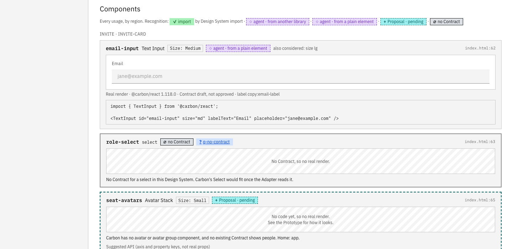

# Prototype: an element whose family has no Contract yet (#90)

Throwaway. Answers one question: when To-handoff meets an element whose family is in the Code Library but has
no Contract, can the Adapter draft that Contract on the spot well enough for the Handoff to render it?

Built on `prototype/html-handoff` (#63). The `email-input` usage in its sample Handoff was a `{raw, reason}`
"no Contract" usage. Here it points at a drafted `text-input` Contract instead.

## What was done

- `design-systems/carbon/contracts/text-input.component.json`: drafted by an agent from the pinned Carbon
  source (v11.118.0, commit 44f90d8) following `skills/adapter-carbon/SKILL.md` §2, `status: "draft"`.
  It has 4 axes (size, validation, readOnly, state), 3 exclusions read from `useNormalizedInputProps.tsx`, and 36 variants.
  `check.mjs` passes rules 1 to 5 on the first try. Rule 6 passes after Foundations is regenerated.
- `skills/adapter-carbon/scripts/foundations.mjs`: one patch. `helperText01/02` set no `fontWeight` (the weight is
  inherited), so the type reader now records `regular` with `fontWeightFrom` and skips that CSS check.
- `design-systems/carbon/carbon.foundations.json`: regenerated from both Contracts. The closure grows from 38 to 51 tokens.
- `docs/prototype/html-handoff/build.mjs`: renders every Contract, not only Button. Required non-visual props
  (`id`) come from a small per-family table.
- `page.js`: a draft Contract's render is captioned "Contract draft, not approved" (#64).
- Run: `node docs/prototype/html-handoff/build.mjs && node docs/prototype/no-contract/shot.mjs`.

## Measurements (pinned Carbon source)

| Family | SCSS / TSX lines | Compiled CSS rules | SCSS variables | Notes |
|---|---|---|---|---|
| Button (existing Contract) | 703 / 565 | 236 | 56 | baseline |
| TextInput | 464 / 577 | 134 | 28 | drafted here |
| Select | 500 / 488 | 145 | 36 | options are `SelectItem` children |
| ToastNotification | 315 / 1486 | 57 | 26 | `kind` defaults to `error`; own `notification.json` tokens |

## Findings

1. **A draft is practical.** TextInput is smaller than Button. The draft is a single pass with no Figma, and the real
   `@carbon/react` component renders from it.
2. **Without a tuple, defaults mislead.** An untupled "Invites sent" toast renders red, because `kind` defaults to
   `error`. A Select with no children renders an empty `<select>`. A lighter "import-only" usage would show wrong renders.
3. **Schema gaps the draft hit.** It lists them as notes rather than inventing fields:
   - rule-driven visibility (worked around with opacity raws);
   - a per-variant icon (warn needs `warning--alt--filled`, which is two paths);
   - a per-variant code prop (`invalidText` vs `warnText`);
   - a per-side stroke (worked around with an Underline frame);
   - required non-visual props (`id`);
   - repeated children (Select options).
4. **Adapter code beyond Button.**
   - Inherited font weight (patched here).
   - `notification.json` component tokens. `foundations.mjs` reads only `button.json`; the file has the same DTCG shape.
   - Toast's close button is a plain `<button>` (`NotificationButton`), so it does not depend on another Contract.
5. **Every new Contract changes the Foundations document.** On this branch `npm test` gives 204 pass and 8 fail.
   The failing tests hard-code the Button-only Foundations: document equality, a closure of 38, and To-design's
   first run creating 75 variables and 2 Text Styles.
