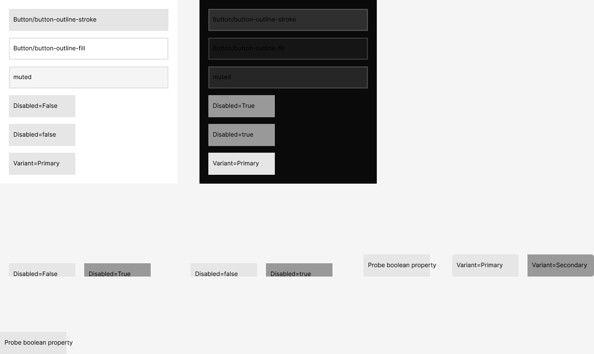

# shadcn probes: same-collection alias, False/True axis

Probes for [pawisssh/design#124](https://github.com/pawisssh/design/issues/124). Parent: [#103](https://github.com/pawisssh/design/issues/103). Vocabulary follows `GLOSSARY.md`.

Probed on 2026-10-16 through the official remote Figma MCP `use_figma`, on the smoke draft `Alpt8YsrzDVu6DnwsrF26h` only. All objects are on the page [`Probe #124`](https://www.figma.com/design/Alpt8YsrzDVu6DnwsrF26h/?node-id=77-8) in a collection of their own, `Probe 124 Theme` (modes Light and Dark), so the draft's Carbon foundations are untouched. Every result below comes from a **separate readback call**, so it shows the state after the writing call ended. Nothing was published, and Code Connect and file settings were not touched.

## Answer

| Question | Result | Decision |
| --- | --- | --- |
| Does a Theme variable aliasing another in the same collection bind and resolve per mode? | Yes | A Synthesized token's plain-token value is a real alias, `{alias, resolved}`. The #103 flattened fallback is retired; an opacity or a `color-mix` stays flattened, since an alias cannot carry alpha. |
| Does Figma refuse an alias cycle? | No. It keeps the old value without an error | The builder core refuses a chain, a cycle or a self-alias within one collection as an `alias-target` conflict, before any write. |
| Does a False/True axis show as a toggle? | Partly observed: it stays a VARIANT property in the API, and a BOOLEAN variable switches it per mode | Keep the Contract's `False`/`True` labels. The properties-panel toggle itself was not observed. |

## 1. Same-collection alias

- In `Probe 124 Theme`: `border` (Light `#e5e5e5`, Dark white at alpha 0.1), `input` (Dark white at alpha 0.15), `background`, `muted`, then `Button/button-outline-stroke` and `Button/button-outline-fill`, the shadcn Synthesized shape.
- `button-outline-stroke` was set per mode with `createVariableAlias`: Light → `border`, Dark → `input`. Readback: `valuesByMode` holds a `VARIABLE_ALIAS` in each mode, and `resolveForConsumer` on a swatch resolves to `#e5e5e5` in the Light frame and to white at alpha 0.15 in the Dark frame (`setExplicitVariableModeForCollection`). The target's alpha carries through the alias.
- **Mixed modes work.** `button-outline-fill` with Light as an alias and Dark as a literal at alpha 0.045 (`bg-input/30`) binds and resolves in both.
- **Order does not matter to Figma.** An alias to a variable created after the aliasing variable was accepted and resolves.
- **A cycle is silently ignored.** `setValueForMode` with an alias that would close a cycle did not throw, and readback still showed the old literal. So Figma cannot be relied on to report it, and the core checks it first.

## 2. False/True axis

- Component sets `Probe toggle (variant False/True)` and `Probe toggle (variant false/true)`: in the API, each axis stays `type: "VARIANT"`, not `BOOLEAN`.
- With the BOOLEAN variable `probe-disabled` (Light `false`, Dark `true`) bound to the instances' variant property, the instances in the Dark frame switched to `Disabled=True` and `Disabled=true`, and those in Light stayed on the false value. Both capitalisations work.
- **Control:** a `Primary`/`Secondary` axis also accepted the binding without an error, but its instances stayed `Primary`.
- The shadcn Button Contract's boolean axes are labelled `False`/`True`, which matches. The instance properties panel was not observed (no desktop access in this run). Figma's help documents boolean variables switching true/false variants ([Use variables in prototypes](https://help.figma.com/hc/en-us/articles/14506587589399-Use-variables-in-prototypes)), and a [forum report](https://forum.figma.com/report-a-problem-6/no-yes-variants-after-being-automatically-converted-to-boolean-are-still-treated-as-string-stopping-boolean-variables-binded-to-an-instance-from-working-16352) describes Figma converting such variants to a boolean toggle in the panel.

## What changed

- **Builder core** (`skills/to-design/assets/builder-core.js`, foundations slice): an alias target may be in the same collection when it has no same-collection alias of its own, and those aliasing variables are created after the rest of their collection. The packager sorts plan keys, so the rule cannot rest on document order. Tests: `skills/to-design/tests/foundations.test.mjs`, "same-collection aliases (#124)". The components core is unchanged.
- **Generic Adapter** (`skills/adapter-generic/scripts/components.mjs`): `var(--x)` in a Synthesized value is `{alias: "x", resolved}`. Two shadcn Synthesized tokens (`button-ghost-expanded-hover-fill`, `button-outline-expanded-hover-fill`) now agree in every mode with the hover tokens, so they merge into them and the Button Contract loses those two rules.
- **Docs:** the value-form table and rule 7 in `skills/contract/references/foundations-schema.md`, and the Synthesized tokens section of `skills/adapter-generic/SKILL.md`.

## Mock build: Button, Card and Alert

`skills/to-design/tests/shadcn.test.mjs` builds the committed Foundations document and the three draft Contracts, approved as a prototype, on the mock figma. It runs the foundations core and then every sets batch of the components core, which is unchanged. Results:

- Button builds 2304 variants, and Card and Alert 2 each.
- The coverage check reports 0 problems for each family.
- The sample check reads back the first, middle and last variant of each family against `resolve()`, and the theme check reads each paint per Mode. Both report 0 problems.

The build turned up two Adapter gaps, both fixed in the Adapter and not the core:

- **A part that hugs had no direction.** Card's and Alert's parts were `{width, height: "hug"}`, but Figma sets HUG only on an Auto Layout frame or on text, and the mock refuses it the same way. A part now carries a `direction`: a flex part's own (CardFooter is a row), else a column.
- **`opacity` was a bare number.** The components core writes a literal from `raw`, so `opacity: 0.5` wrote nothing. It is now `{raw, level: "info", reason}`.

No live component build was run. The smoke draft's `Theme` collection belongs to its Carbon foundations, so a shadcn foundations build there stops at an `unowned` conflict, by design.

## Left on the smoke draft

Page `Probe #124` (`77:8`) with the frames `Mode Light` and `Mode Dark`, the four probe component sets, and the collection `Probe 124 Theme`. They are kept as evidence; delete the page and the collection to clear them.
