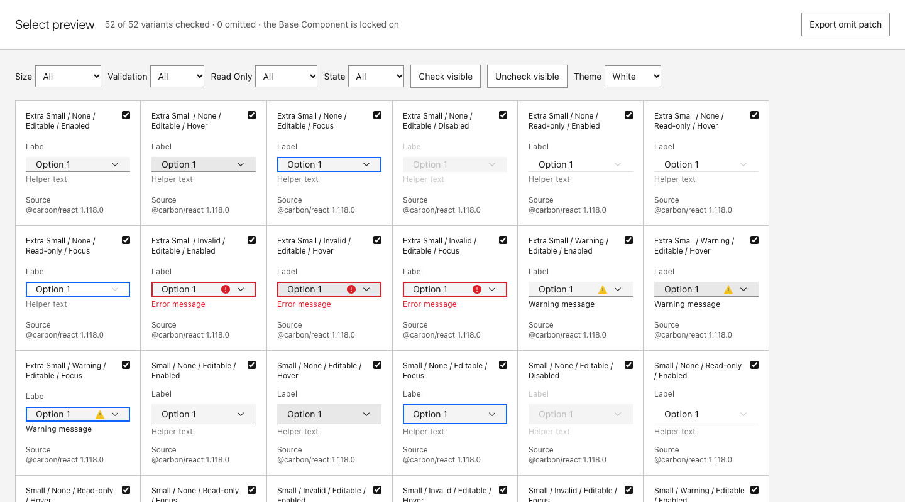

# Prototype: what the Contract schema needs for form-control families (#93)

Throwaway. #90 drafted a TextInput Contract and found six places where the schema forced a workaround. This
prototype settles each one on TextInput and a second form control, Select, and checks the answers three ways:
`check.mjs`, real Carbon markup through To-preview's renderer, and a To-design build on the mock Figma with
both builder cores unchanged (ADR 0001).

Built on `prototype/slot-styling` (#88, the `visible` layout field) and `prototype/no-contract` (#90, the TextInput
draft and the Handoff build).



## Answers

| # | Gap from #90 | Answer | Schema | Cores |
|---|---|---|---|---|
| 1 | No rule-driven visibility: the status icon and messages hid by `opacity: 0` and kept their space | #88's `visible` layout field, set by any rule, not only a Slot axis | wording only | none |
| 2 | One icon per INSTANCE: warn showed invalid's icon tinted yellow | One INSTANCE per icon (`Invalid icon` = `icon:warning--filled`, `Warn icon` = `icon:warning--alt--filled`), each shown by `visible`. `icons()` adds every fixed `icon:<key>` to the icon list | none (`icon:<key>` already parsed) | none |
| 2b | `warning--alt--filled` is two-tone (inner mark `$black-100` from CSS) | Stays one Vector; a `verify` note says the mark is cut out, not black. Follow-up ticket | none | would need one |
| 3 | One code prop per property: the message was `invalidText` or `warnText` by variant | Two TEXT nodes and two properties, each shown by `visible`. A snippet leaves out a TEXT prop whose node the tuple hides [assumption] | none | none |
| 4 | One `strokeWeight` per node: the underline is a bottom border | The side is its own FRAME (`Underline`), now the documented rule, with a revisit trigger | doc only | none |
| 5 | `id` is required and nothing sets it | `code.required: ["id"]`. To-preview gives a placeholder per tuple; the Handoff gives the usage id. #90's per-family `REQUIRED` table is deleted | new field | none |
| 6 | Repeated children (Select options) | `code.items: {component: "SelectItem", props: ["value", "text"]}`; the Handoff usage lists `items`; a TEXT property with `code.itemProp: "text"` shows the selected item's text in Figma | new fields | none |

## What changed

- `skills/contract/contract.schema.json`, `scripts/contract.mjs`: `code.required`, `code.items`, property
  `code.itemProp`, with rule 3 checks; `icons()` adds fixed `icon:<key>` refs. Tests in `test/contract.test.mjs`.
- `skills/contract/references/contract-schema.md`: a Code section, the per-version node pattern, the side-border rule,
  the wider `visible` wording, the derived icon list.
- `design-systems/carbon/contracts/text-input.component.json`: rewritten with `visible` rules, separate icons and
  messages, `invalidText` and `warnText`, `code.required`. No opacity hacks remain.
- `design-systems/carbon/contracts/select.component.json`: new draft, 52 variants, from the pinned Carbon source.
- `design-systems/carbon/carbon.foundations.json`: regenerated from three Contracts (54 tokens).
- `skills/to-design/scripts/build-plan.mjs`: two fixes the build exposed. `UNPAINTED` also drops `opacity="0"`
  shapes: 16px `warning--filled` marks its inner path that way, and flattening it in filled the mark (a solid disc).
  The sets self-check leaves out `visible`, which #88 moved from the layout into the wiring.
- `skills/adapter-carbon/scripts/preview.mjs`: renders `code.required` and `code.items`.
- `skills/to-preview/assets/catalog-template.html`: a forced State class goes on every element of the specimen,
  because a form control styles `:hover` and `:focus` on its nested `<select>` or `<input>`, not its root.
- `docs/prototype/html-handoff/`: `role-select` is a Select usage with `items`. The snippet writes `<SelectItem>`
  children, and `id` comes from `code.required`.

## Checks

```bash
node skills/contract/scripts/check.mjs design-systems/carbon/contracts/select.component.json
node prototypes/form-schema/dom-check.mjs
node prototypes/form-schema/mock-build.mjs
node skills/to-preview/scripts/catalog.mjs design-systems/carbon/contracts/select.component.json
node docs/prototype/html-handoff/build.mjs
```

- `check.mjs`: TextInput, Select and Button are valid.
- `dom-check.mjs` renders every selected tuple with real `@carbon/react`. It compares the markup with what
  `resolve()` says is visible: helper text, invalid and warn messages, invalid and warn icons, and for Select the
  chevron and the option. Results: TextInput 36 × 5, Select 52 × 7, 0 mismatches. Dropping the warn `visible` rule
  makes it fail on every warn tuple.
- `mock-build.mjs` builds foundations, the three icons, and every sets batch for both families on To-design's mock
  Figma with the unchanged cores. Results: 36/36 and 52/52 variants, 0 coverage problems. In every variant each
  node's visibility matches the Contract, and each status icon is an instance of its own icon.
- Handoff snippet for `role-select`:
  `<Select id="role-select" size="md" labelText="Role">` with three `<SelectItem value text />` children.

The smoke Figma draft was not needed: the mock build runs the same cores, and nothing here depends on Figma
behaviour the mock does not model.

## Limits found

- To-preview cannot force Focus over Carbon's invalid outline. That outline is on `:not(:focus)`, which a forced class
  does not cancel, so Invalid + Focus still shows red. The Contract (focus wins) matches real Carbon.
- `npm test`: the 8 failures are the same as on `prototype/no-contract` (#90). Those tests compare against
  Button-only Foundations, and the committed document now has more than Button. Whole-theme Foundations (#59)
  removes this.
